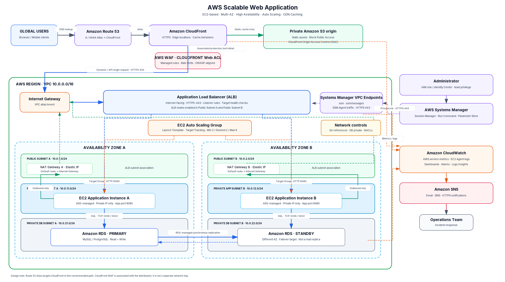

# تطبيق ويب قابل للتوسع على AWS باستخدام ALB وAuto Scaling

> **نوع البنية:** تطبيق EC2 بثلاث طبقات  
> **التوافر:** منطقتا توافر Availability Zones داخل Region واحدة  
> **توزيع المحتوى:** CloudFront + AWS WAF  
> **طبقة التطبيق:** Application Load Balancer + EC2 Auto Scaling Group  
> **قاعدة البيانات:** Amazon RDS MySQL أو PostgreSQL بنمط Multi-AZ

يوثق هذا المستودع تصميمًا مرجعيًا لتطبيق ويب قابل للتوسع على AWS. يفصل التصميم بين طبقة الحافة وتوزيع المحتوى، وطبقة التطبيق، وطبقة قاعدة البيانات. كما يضع خوادم EC2 داخل شبكات خاصة ويوزع الموارد على منطقتي توافر لتقليل الاعتماد على منطقة واحدة.

**نطاق المستودع الحالي:** يحتوي هذا المستودع على المخطط المعماري والتوثيق. لا يدّعي أن البنية نُشرت بالفعل على AWS، ولا يتضمن حاليًا ملفات Terraform أو CloudFormation. يجب إضافة نتائج النشر واختبارات الأداء والتكلفة الفعلية بعد تنفيذ البيئة.

---

## 1. المخطط المعماري للحل

مسار الطلب الأساسي في التصميم الموصى به:

**المستخدمون ← Route 53 ← CloudFront + AWS WAF ← ALB ← EC2 Auto Scaling Group ← RDS Multi-AZ**

تُخزّن الملفات الثابتة في S3 خاص، ويصل إليها CloudFront باستخدام Origin Access Control. أما طلبات التطبيق وواجهات API فتُوجّه إلى ALB.



- [فتح المخطط بصيغة SVG](docs/architecture.svg)
- [عرض الرسم الأصلي المرفق بالمشروع](docs/architecture-reference.png)
- [مصدر إنشاء المخطط](docs/draw_architecture.py)

### أهداف التصميم

- توزيع الموارد على Availability Zones اثنتين.
- عدم منح خوادم EC2 عناوين IP عامة.
- التوسع الأفقي تلقائيًا عبر Auto Scaling Group.
- توزيع طلبات HTTP/HTTPS وفحص صحة الخوادم عبر ALB.
- تخزين الملفات الثابتة مؤقتًا عبر CloudFront.
- حماية طلبات الويب بواسطة AWS WAF.
- توافر قاعدة البيانات باستخدام RDS Multi-AZ.
- إدارة الخوادم الخاصة باستخدام Systems Manager دون فتح SSH.
- مراقبة مركزية عبر CloudWatch وإشعارات SNS.

### توضيحات معمارية مهمة

1. **في التصميم الموصى به يوجّه Route 53 النطاق إلى CloudFront.** ثم يختار CloudFront المصدر المناسب لكل طلب. إذا كانت متطلبات التقييم تشترط Route 53 Alias إلى ALB مباشرة، راجع القسم 12.
2. **WAF مرتبط بتوزيعة CloudFront وليس جهازًا شبكيًا يمر عبره الطلب كقفزة منفصلة.** يتم إنشاء Web ACL بنطاق CloudFront في منطقة `us-east-1`. يمكن إضافة Web ACL إقليمية أخرى مرتبطة بـALB كطبقة حماية إضافية.
3. **أُضيف S3 كمصدر للملفات الثابتة.** تبقى الحاوية خاصة ويُسمح لـCloudFront بالوصول إليها عبر OAC فقط.
4. **ALB إنترنتي وموجود عبر الشبكتين العامتين، بينما EC2 داخل الشبكات الخاصة.**
5. **RDS يدير عقدة Primary وStandby.** مواقع العقدتين في AZ-A وAZ-B في الرسم توضيحية وقد تتبدل الأدوار بعد Failover.
6. **المستخدم هنا هو نمط RDS Multi-AZ DB Instance مع Standby واحدة.** لا تستخدم Standby لتوزيع استعلامات القراءة؛ فهي مخصصة للتعافي التلقائي. استخدم Read Replica أو Multi-AZ DB Cluster عند الحاجة إلى توسيع القراءة.

---

## 2. خدمات AWS وأدوارها

| الطبقة | الخدمة | الدور |
|---|---|---|
| DNS | Route 53 | Hosted Zone وسجلات A/AAAA Alias |
| Edge | CloudFront | التوزيع العالمي، TLS، التخزين المؤقت، اختيار المصدر |
| الحماية | AWS WAF | قواعد الحماية، تحديد المعدل، تصفية الطلبات |
| الملفات الثابتة | S3 | تخزين CSS وJavaScript والصور والخطوط |
| الشبكة | VPC | شبكة معزولة تحتوي على Public وPrivate Subnets |
| الاتصال بالإنترنت | Internet Gateway | مسار الإنترنت للشبكات العامة وخروج NAT |
| الخروج | NAT Gateway A وB | اتصالات IPv4 الصادرة من الشبكات الخاصة |
| توزيع الطلبات | ALB | HTTPS Listener وTarget Groups وHealth Checks |
| التطبيق | EC2 | تشغيل التطبيق داخل Private Subnets |
| التوسع | Auto Scaling Group | زيادة وتقليل عدد الخوادم واستبدال الخوادم غير السليمة |
| قاعدة البيانات | RDS | MySQL/PostgreSQL مع Multi-AZ Failover |
| الإدارة | Systems Manager | Session Manager وRun Command وParameter Store |
| المراقبة | CloudWatch | Metrics وLogs وDashboards وAlarms |
| الإشعارات | SNS | إرسال التنبيهات إلى البريد أو SMS أو HTTPS |
| الأسرار والتشفير | Secrets Manager وKMS | بيانات الاعتماد ومفاتيح التشفير |

---

## 3. تصميم الشبكة VPC

### تقسيم CIDR المقترح

العناوين التالية أمثلة للمشروع. تأكد من عدم تعارضها مع شبكات VPN أو الشبكات المحلية أو VPCs متصلة أخرى.

| Availability Zone | Subnet | CIDR | الاستخدام |
|---|---|---|---|
| AZ-A | Public Subnet A | `10.0.1.0/24` | ALB وNAT Gateway A |
| AZ-B | Public Subnet B | `10.0.2.0/24` | ALB وNAT Gateway B |
| AZ-A | Private App Subnet A | `10.0.11.0/24` | خوادم EC2 للتطبيق |
| AZ-B | Private App Subnet B | `10.0.12.0/24` | خوادم EC2 للتطبيق |
| AZ-A | Private DB Subnet A | `10.0.21.0/24` | عضو في RDS DB Subnet Group |
| AZ-B | Private DB Subnet B | `10.0.22.0/24` | عضو في RDS DB Subnet Group |

VPC CIDR: `10.0.0.0/16`

### Route Tables

| جدول التوجيه | Destination | Target | الشبكة |
|---|---|---|---|
| Public RT A/B | `10.0.0.0/16` | `local` | الشبكات العامة |
| Public RT A/B | `0.0.0.0/0` | Internet Gateway | الشبكات العامة |
| Private App RT A | `10.0.0.0/16` | `local` | App A |
| Private App RT A | `0.0.0.0/0` | NAT Gateway A | App A |
| Private App RT B | `10.0.0.0/16` | `local` | App B |
| Private App RT B | `0.0.0.0/0` | NAT Gateway B | App B |
| Private DB RT A/B | `10.0.0.0/16` | `local` | شبكات قاعدة البيانات |

لا تضف Default Route إلى الإنترنت أو NAT على شبكات قاعدة البيانات. أضف فقط المسارات المحددة المطلوبة لخدمات VPC Endpoints عند الحاجة.

### NAT Gateway

أنشئ NAT Gateway مستقلة داخل كل Availability Zone، واجعل Private App Subnet A تستخدم NAT-A وPrivate App Subnet B تستخدم NAT-B. استخدام NAT واحدة مشتركة قد يجعل الشبكة الخاصة في AZ الأخرى تفقد اتصال الإنترنت الصادر عند تعطل AZ التي تحتوي على NAT.

NAT Gateway مخصصة للاتصالات الصادرة، وليست مسار دخول زوار التطبيق.

### حدود الشبكة

- Public Subnets: تحتوي على ALB وNAT Gateway فقط، ولا تضع فيها EC2 الخاصة بالتطبيق.
- Private App Subnets: تحتوي على EC2 دون Public IP، وتستخدم NAT الموجودة في AZ نفسها للاتصالات الصادرة.
- Private DB Subnets: مخصصة لمجموعة RDS، ولا تحتوي على مسار إنترنت عام.
- Security Groups: تتحكم في الاتصال بين الخدمات، وهي Stateful. استخدم Security Group References بدل السماح الواسع بعناوين IP.
- NACLs: تعمل على مستوى Subnet وهي Stateless؛ لذلك يجب ضبط قواعد الذهاب والعودة ومنافذ Ephemeral Ports عند استخدام قواعد مقيّدة.

---

## 4. تدفق البيانات من المستخدم إلى قاعدة البيانات

### 4.1 DNS وCloudFront

1. يطلب المستخدم `https://app.example.com`.
2. يحل Route 53 اسم النطاق عبر A/AAAA Alias إلى CloudFront.
3. ينشئ المتصفح اتصال HTTPS مع أقرب CloudFront Edge Location مناسب.
4. يطبق CloudFront Cache Behavior، وتفحص AWS WAF Web ACL الطلب.

### 4.2 طلب الملفات الثابتة

أمثلة: `/assets/app.js` و`/assets/site.css` و`/images/logo.webp`.

1. يختار CloudFront سلوك الملفات الثابتة.
2. عند Cache Hit يُعاد الملف مباشرة دون الاتصال بخوادم EC2.
3. عند Cache Miss يجلب CloudFront الملف من S3 الخاص باستخدام OAC.
4. يخزن CloudFront الملف وفق Cache Policy وTTL ثم يعيده للمستخدم.

استخدم أسماء ملفات Versioned أو Fingerprinted حتى يمكن تفعيل TTL طويل دون عرض ملفات قديمة بعد التحديث. أبقِ S3 Block Public Access مفعّلًا.

### 4.3 طلبات التطبيق وواجهات API

أمثلة: `/dashboard` و`/api/users` و`/api/auth/login`.

1. يوجّه CloudFront الطلب إلى ALB Origin.
2. ينشئ CloudFront اتصال HTTPS على المنفذ 443.
3. يطبق ALB قواعد Listener ويفحص Target Group.
4. يرسل الطلب إلى خادم EC2 سليم على منفذ التطبيق، مثل 8080.
5. ينفذ التطبيق منطق العمل ويتصل بقاعدة البيانات عبر RDS Writer Endpoint.
6. تعود الاستجابة من EC2 إلى ALB ثم CloudFront ثم المتصفح.

لا تخزن استجابات الحسابات أو البيانات الخاصة بالمستخدمين في Cache مشترك. عطّل التخزين المؤقت لمسارات المصادقة والـAPI الخاصة افتراضيًا، ومرّر Cookies وHeaders وQuery Strings التي يحتاجها التطبيق فقط.

### 4.4 الاتصال بقاعدة البيانات

- MySQL: TCP `3306`.
- PostgreSQL: TCP `5432`.
- تتصل EC2 بـRDS Writer Endpoint وليس بعنوان IP ثابت.
- بعد Failover يحدث RDS سجل DNS الخاص بالـEndpoint؛ يجب على التطبيق التخلص من الاتصالات القديمة وإعادة الاتصال.
- استخدم Connection Pooling ومحاولات إعادة اتصال محدودة مع Backoff، ولا تعاود تنفيذ معاملة غير Idempotent دون حماية من تكرار العملية.

---

## 5. ALB وHealth Checks

الإعدادات الأولية المقترحة:

| الإعداد | القيمة |
|---|---|
| ALB Scheme | Internet-facing |
| ALB Subnets | Public A وPublic B |
| اتصال CloudFront إلى ALB | HTTPS 443 |
| Listener | HTTPS 443 مع ACM Certificate |
| Target Type | Instance أو IP بحسب التنفيذ |
| Target Port | TCP 8080 كمثال |
| Health Check Path | `/health` أو Readiness Endpoint |
| Success Code | HTTP 200 |

يجب أن يفحص Health Endpoint قدرة التطبيق على استقبال الطلبات دون تنفيذ استعلامات مكلفة إلى قاعدة البيانات في كل فحص. اضبط Deregistration Delay بما يتوافق مع مدة الطلبات وآلية إيقاف التطبيق بأمان.

---

## 6. EC2 Auto Scaling

قيم أولية توضيحية، وتُعدّل بعد Load Testing:

| الإعداد | القيمة |
|---|---:|
| Minimum | 2 |
| Desired | 2 |
| Maximum | 6 |
| التوزيع | Private App A وPrivate App B |
| Scaling Policy | Target Tracking |
| Health Checks | EC2 + ELB |

### Launch Template

- AMI محدثة ومدعومة.
- Instance Type يتم تحديده بعد اختبار الأداء.
- IAM Instance Profile بأقل الصلاحيات اللازمة.
- EBS مشفر باستخدام KMS.
- فرض استخدام IMDSv2.
- عدم تعيين Public IP.
- تثبيت SSM Agent وCloudWatch Agent.
- نشر التطبيق بواسطة Bootstrap أو عملية Deployment قابلة للتكرار.
- جلب الأسرار أثناء التشغيل من Secrets Manager أو Parameter Store SecureString، وعدم وضع كلمات المرور في User Data أو ملفات المستودع.

### سياسة التوسع

يمكن البدء بأحد المقياسين التاليين:

- `ASGAverageCPUUtilization` للتطبيقات التي يهيمن عليها استهلاك المعالج.
- `ALBRequestCountPerTarget` عند كون عدد الطلبات لكل خادم مؤشرًا أفضل للسعة.

تُحدد القيمة المستهدفة ووقت Warm-up بناءً على اختبار أحمال واقعي.

### متطلبات التطبيق للتوسع الأفقي

- اجعل التطبيق Stateless قدر الإمكان.
- لا تخزن Sessions أو الملفات الدائمة على قرص EC2 المحلي فقط.
- استخدم Session Store خارجيًا أو Tokens موقعة دون حالة حسب الحاجة.
- خزّن الملفات المشتركة والمرفوعة في S3 أو خدمة تخزين مشتركة.
- لا يصبح الخادم Healthy قبل اكتمال تهيئة التطبيق.

---

## 7. قاعدة البيانات RDS Multi-AZ

أنشئ DB Subnet Group يضم Private DB Subnet A وB، ثم فعّل Multi-AZ DB Instance Deployment.

### في الوضع الطبيعي

- Primary تستقبل القراءة والكتابة.
- ينسخ RDS البيانات بصورة متزامنة إلى Standby في AZ أخرى.
- Standby لا تقدم قراءات للتطبيق في نمط Multi-AZ DB Instance.

### عند حدوث Failover

عند اكتشاف عطل مناسب في Primary، يرقّي RDS نسخة Standby ويحدث سجل DNS الخاص بـEndpoint. يستغرق Failover عادةً نحو 60–120 ثانية في ظروف كثيرة، لكن المدة الفعلية تختلف بحسب نشاط قاعدة البيانات والتعافي. يجب أن يدعم التطبيق انقطاع الاتصالات المؤقت وإعادة الاتصال.

### حماية قاعدة البيانات

- عدم إتاحة قاعدة البيانات للعامة.
- السماح بالاتصال من Security Group التطبيق فقط على منفذ المحرك.
- التشفير باستخدام KMS وTLS للاتصالات.
- تفعيل Automated Backups وPoint-in-Time Recovery.
- إنشاء Snapshots قبل التغييرات الحساسة واختبار Restore دوريًا.
- تخزين كلمات المرور في Secrets Manager.
- مراقبة CPU وFree Storage وDatabase Connections وLatency وأحداث RDS.

**مهم:** Multi-AZ لا يغني عن Backups، وStandby في Multi-AZ DB Instance ليست Read Replica. استخدم Read Replica أو Multi-AZ DB Cluster عند الحاجة إلى توسيع القراءة بعد مراجعة المتطلبات والقيود.

---

## 8. ضوابط الأمان

### Security Group Rules

| Security Group | مصدر الاتصال | المنفذ | الغرض |
|---|---|---:|---|
| `sg-alb` | CloudFront origin-facing managed prefix list | TCP 443 | السماح بطلبات CloudFront إلى ALB |
| `sg-app` | `sg-alb` | TCP 8080 | ALB إلى خوادم التطبيق |
| `sg-db` | `sg-app` | TCP 3306 أو 5432 | التطبيق إلى قاعدة البيانات |
| `sg-ssm-endpoints` | `sg-app` | TCP 443 | EC2 إلى SSM Interface Endpoints |

لا تفتح TCP 22 من `0.0.0.0/0`. استخدم Session Manager لإدارة الخوادم.

### منع تجاوز CloudFront والوصول المباشر إلى ALB

1. قيّد Inbound في Security Group الخاص بـALB إلى AWS-managed CloudFront origin-facing prefix list، وأضف IPv6 prefix list إذا كان IPv6 مفعّلًا.
2. أضف Custom Origin Header عشوائيًا وعالي القوة من CloudFront، واجعل ALB Listener يمرر الطلبات التي تحتوي على هذا الـHeader فقط، ويعيد `403` للطلبات الأخرى.

لا تحفظ قيمة الـHeader في المستودع العام. تعامل معها كسرّ، واحمِ Terraform State عند استخدام Terraform، وغيّر القيمة دوريًا. Prefix List وحدها تسمح لخوادم CloudFront origin-facing عمومًا؛ والـHeader يضيف ربطًا بالتوزيعة المقصودة.

### AWS WAF

يمكن استخدام Managed Rule Groups وقواعد مخصصة مثل:

- Core Rule Set للهجمات الشائعة على تطبيقات الويب.
- SQL Injection protection.
- Known Bad Inputs وIP Reputation.
- Rate-based rules لتقليل الطلبات المفرطة.
- قواعد خاصة بالتطبيق للـAllow/Block وحجم الطلب.

ابدأ بوضع Count حيثما أمكن، راجع الطلبات المسجلة، ثم حوّل القواعد المختبرة إلى Block. WAF طبقة حماية إضافية ولا يغني عن التحقق من المدخلات والتفويض والتحديثات الأمنية والبرمجة الآمنة.

### التشفير والهوية

- شهادات ACM لـCloudFront وALB. شهادة CloudFront Viewer تكون في `us-east-1`، بينما شهادة ALB تكون في Region الخاصة به.
- KMS لتشفير EBS وRDS وS3 والسجلات والأسرار بحسب الحاجة.
- Secrets Manager للأسرار وبيانات الاتصال.
- IAM Least Privilege واستخدام Roles بدل Access Keys طويلة العمر.
- فرض IMDSv2 على EC2.
- S3 Block Public Access مع OAC Bucket Policy للتوزيعة المقصودة.
- تفعيل CloudTrail لتسجيل عمليات الحساب.

---

## 9. الإدارة عبر Systems Manager

استخدم Session Manager وRun Command لإدارة EC2 دون فتح SSH Inbound.

للاتصال الخاص، أنشئ Interface VPC Endpoints لخدمات Systems Manager المطلوبة، وغالبًا تشمل:

```text
com.amazonaws.<region>.ssm
com.amazonaws.<region>.ssmmessages
com.amazonaws.<region>.ec2messages  # عند الحاجة حسب Region وإصدار Agent والميزة
```

أنشئ Endpoint ENIs في أكثر من AZ لتحسين استمرارية مسار الإدارة. اسمح بـTCP 443 من Security Group الخاص بخوادم التطبيق إلى Security Group الخاص بالـEndpoints. قد تحتاج أيضًا إلى Endpoints لـKMS وCloudWatch Logs وS3 بحسب الميزات المستخدمة.

---

## 10. المراقبة والتنبيهات

| الخدمة | المقاييس المهمة |
|---|---|
| ALB | أخطاء 5XX وTargetResponseTime وHealthyHostCount وUnHealthyHostCount وRequestCount |
| EC2 | CPU؛ والذاكرة والقرص عبر CloudWatch Agent؛ وسجلات النظام والتطبيق |
| ASG | Desired وInService وPending وعدد عمليات التوسع |
| RDS | CPU وDatabaseConnections وFreeStorageSpace وRead/Write Latency والأحداث |
| CloudFront | Requests وBytes و4xx/5xx وCache Hit Ratio |
| WAF | الطلبات المحظورة والمسموحة حسب القاعدة وسجلات WAF |

أنشئ CloudWatch Dashboards وAlarms لارتفاع الأخطاء أو زمن الاستجابة أو وجود Targets غير سليمة أو انخفاض سعة ASG أو قرب نفاد مساحة RDS. استخدم CloudWatch Agent لمقاييس الذاكرة والقرص التي لا تُرسل افتراضيًا.

ترسل CloudWatch Alarms إشعاراتها إلى SNS Topic. أضف مستلمي البريد أو SMS أو HTTPS واختبر وصول التنبيه عمليًا؛ إنشاء SNS Topic وحده لا يثبت نجاح الإشعارات.

---

## 11. سيناريوهات الأعطال

| العطل | السلوك المتوقع والاختبار |
|---|---|
| تعطل EC2 | يستبعده ALB بعد فشل Health Check ويستبدله ASG |
| تعطل AZ-A | يستقبل AZ-B الطلبات، بشرط امتلاكها سعة تكفي للحمل المتوقع |
| زيادة الطلبات | يوسع Target Tracking مجموعة ASG |
| تعطل RDS Primary | يرقّي RDS الـStandby ويعيد التطبيق الاتصال عبر Writer Endpoint نفسه |
| تعطل NAT-A أو AZ-A | يستمر خروج موارد AZ-B عبر NAT-B |
| CloudFront Cache Miss | يطلب الملف من S3 أو يرسل طلب التطبيق إلى ALB حسب Cache Behavior |
| WAF False Positive | تُراجع السجلات وتُعدّل القاعدة ويُعاد الاختبار دون تعطيل الحماية كليًا |
| حذف أو تلف بيانات RDS | يتم Restore من Automated Backup/PITR أو Snapshot؛ Multi-AZ وحدها لا تعيد نقطة زمنية سابقة |

حدد RTO وRPO المطلوبين قبل الإنتاج. Multi-AZ داخل Region واحدة لا تحمي من كل أعطال المنطقة بالكامل؛ التعافي عبر Region أخرى يحتاج تصميمًا واختبارات مستقلة.

---

## 12. بديل DNS عند اشتراط Route 53 Alias إلى ALB

إذا كان التقييم يشترط حرفيًا توجيه Route 53 إلى ALB مباشرة، استخدم نطاقين:

- `app.example.com` → Route 53 Alias → ALB للطلبات الديناميكية.
- `static.example.com` → Route 53 Alias → CloudFront → S3 خاص باستخدام OAC للملفات الثابتة.

هذا يحقق شرط Alias إلى ALB، لكنه لا يجعل طلبات التطبيق تمر عبر CloudFront ولا يستفيد من حماية الحافة أو Cache الخاص به. لا تفترض أن تسجيل CloudFront في DNS يعني أن حركة التطبيق تمر عبره إذا كان النطاق الرئيسي يشير مباشرة إلى ALB.

في التصميم الموصى به في هذا المستودع، استخدم Route 53 Alias → CloudFront. سجلات CloudFront Alias في Route 53 لا تدعم `EvaluateTargetHealth`؛ اتركه معطلًا حسب توثيق AWS. عند الحاجة إلى DNS Failover صمم Health Checks وسياسات توجيه منفصلة واختبرها.

---

## 13. ترتيب التنفيذ

1. تحديد Region والنطاق وCIDR ومحرك قاعدة البيانات وRTO/RPO وسقف التكلفة.
2. إنشاء VPC والشبكات الست عبر AZs اثنتين، وRoute Tables وIGW وNAT Gateways وVPC Endpoints.
3. إعداد Security Groups وNACLs وKMS وIAM Roles وSecrets Manager.
4. إنشاء RDS DB Subnet Group وقاعدة بيانات Multi-AZ مشفرة مع Backups.
5. تجهيز AMI أو Bootstrap للتطبيق وتثبيت SSM Agent وCloudWatch Agent.
6. إنشاء Launch Template وAuto Scaling Group.
7. إنشاء ALB وHTTPS Listener وTarget Group وHealth Check.
8. إنشاء S3 الخاص وOAC وCloudFront Behaviors وWAF وتقييد الوصول إلى ALB.
9. إعداد شهادات ACM في المناطق المطلوبة وسجلات Route 53.
10. إعداد CloudWatch Dashboards وAlarms وSNS وCloudTrail وSession Manager logging.
11. اختبار التطبيق والأمان والأحمال وفقدان AZ وRDS Failover وRestore والإشعارات.

---

## 14. قائمة التحقق من التسليم

- [ ] نشر VPC والشبكات الست عبر AZs اثنتين دون تداخل CIDR.
- [ ] توجيه Public Subnets إلى IGW وPrivate App Subnets إلى NAT الموجودة في AZ نفسها.
- [ ] عدم وجود Default Internet Route في شبكات قاعدة البيانات.
- [ ] تشغيل ALB في Public A وPublic B وتوجيهه إلى EC2 الخاصة فقط.
- [ ] تشغيل EC2 دون Public IP وإدارتها عبر ASG في AZs الاثنتين.
- [ ] اختبار Health Checks وELB health checks لـASG.
- [ ] ربط CloudFront بـS3 OAC للملفات الثابتة وبـALB للطلبات الديناميكية.
- [ ] منع تخزين ردود المصادقة والبيانات الخاصة بالخطأ.
- [ ] ربط WAF بـCloudFront واختبار القواعد.
- [ ] منع الوصول المباشر غير الموثوق إلى ALB.
- [ ] تشغيل RDS Multi-AZ مشفرة وخاصة مع Backups واختبار Restore.
- [ ] اختبار إعادة اتصال التطبيق بعد RDS Failover.
- [ ] نجاح Session Manager دون فتح SSH.
- [ ] نجاح CloudWatch Alarms واستلام إشعارات SNS.
- [ ] توثيق اختبارات Load وScale-out وScale-in وفقدان EC2/AZ واستعادة قاعدة البيانات.

---

## 15. هيكل المستودع

```text
aws-scalable-web-app/
├── README.md
├── README.ar.md
├── .gitignore
└── docs/
    ├── architecture.png
    ├── architecture.svg
    ├── architecture-reference.png
    ├── draw_architecture.py
    └── requirements.txt
```

`architecture.png` و`architecture.svg` هما المخططان المنقحان. أما `architecture-reference.png` فهو الرسم الأصلي المرفق بالمشروع. يُحتفظ به كمرجع، ويُعتمد المخطط المنقح لأنه يوضح S3 كمصدر للملفات الثابتة ويصحح علاقة CloudFront وWAF.

---

## 16. التكلفة وملاحظات الإنتاج

تحتوي هذه المعمارية على موارد مدفوعة حتى مع انخفاض الحركة، ومنها NAT Gateway عدد 2 وALB وEC2 وRDS Multi-AZ وCloudFront وS3 وWAF وLogs وVPC Endpoints ونقل البيانات. يجب إعداد تقدير حسب Region باستخدام AWS Pricing Calculator قبل التنفيذ. قد تكون معالجة NAT Gateway ونقل البيانات بين AZs من عوامل التكلفة المهمة؛ ويمكن استخدام VPC Endpoints لتقليل المرور عبر NAT للخدمات المدعومة.

لا ترفع إلى المستودع العام AWS Account IDs أو مفاتيح الوصول أو كلمات المرور أو Private Keys أو Terraform State أو ملفات `.env` أو سجلات تحتوي على بيانات حقيقية أو أسرار.

---

## 17. مراجع AWS الرسمية

- [Route 53: توجيه النطاق إلى CloudFront](https://docs.aws.amazon.com/Route53/latest/DeveloperGuide/routing-to-cloudfront-distribution.html)
- [CloudFront: تقييد الوصول إلى S3 باستخدام OAC](https://docs.aws.amazon.com/AmazonCloudFront/latest/DeveloperGuide/private-content-restricting-access-to-s3.html)
- [CloudFront: تقييد الوصول إلى Application Load Balancer](https://docs.aws.amazon.com/AmazonCloudFront/latest/DeveloperGuide/restrict-access-to-load-balancer.html)
- [AWS WAF: الموارد التي يمكن حمايتها](https://docs.aws.amazon.com/waf/latest/developerguide/how-aws-waf-works-resources.html)
- [ALB: إنشاء Application Load Balancer](https://docs.aws.amazon.com/elasticloadbalancing/latest/application/create-application-load-balancer.html)
- [Auto Scaling: Target Tracking](https://docs.aws.amazon.com/autoscaling/ec2/userguide/as-scaling-target-tracking.html)
- [NAT Gateway: الأساسيات والتوافر عبر AZs](https://docs.aws.amazon.com/vpc/latest/userguide/nat-gateway-basics.html)
- [RDS: Multi-AZ DB Instance](https://docs.aws.amazon.com/AmazonRDS/latest/UserGuide/Concepts.MultiAZSingleStandby.html)
- [RDS: Failover](https://docs.aws.amazon.com/AmazonRDS/latest/UserGuide/Concepts.MultiAZ.Failover.html)
- [RDS: Automated Backups وPITR](https://docs.aws.amazon.com/AmazonRDS/latest/UserGuide/USER_WorkingWithAutomatedBackups.html)
- [Systems Manager: VPC Endpoints](https://docs.aws.amazon.com/systems-manager/latest/userguide/setup-create-vpc.html)
- [Session Manager باستخدام PrivateLink](https://docs.aws.amazon.com/systems-manager/latest/userguide/session-manager-getting-started-privatelink.html)

---

## 18. نشر المستودع على GitHub

1. أنشئ مستودعًا **عامًا Public وفارغًا** في GitHub باسم `aws-scalable-web-app`، ولا تختر إضافة README أو License من GitHub أثناء الإنشاء.
2. فك ضغط الحزمة، ثم نفّذ الأوامر التالية من مجلد المشروع:

```bash
git init -b main
git add .
git commit -m "docs: add AWS scalable web app architecture"
git remote add origin https://github.com/<GITHUB-USERNAME>/aws-scalable-web-app.git
git push -u origin main
```

3. افتح صفحة المستودع وتأكد من ظهور `README.md` والمخطط المعماري. استبدل `<GITHUB-USERNAME>` باسم حسابك في GitHub.

لم أضف License افتراضيًا لأن اختيار الترخيص قرار يعود إلى مالك المشروع. لإعادة توليد PNG بعد تعديل مصدر الرسم، ثبّت المتطلب الموجود في `docs/requirements.txt` ثم نفّذ `python docs/draw_architecture.py`.

---

## حالة المشروع

**المخرج الحالي:** توثيق ومخطط معماري مرجعي.  
**المرحلة التالية:** تنفيذ طبقة الشبكة وقاعدة البيانات، ثم نشر طبقة التطبيق والتحقق من تدفق الطلبات من البداية إلى النهاية.
