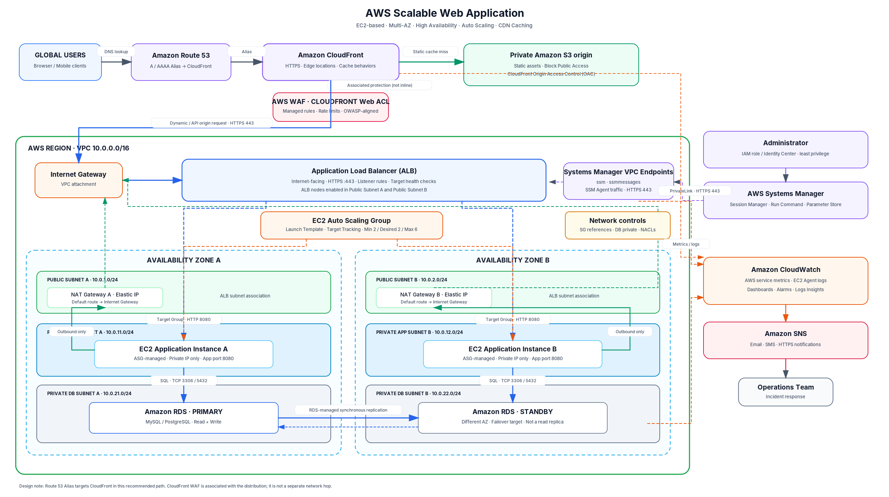

# AWS Scalable Web Application with ALB and Auto Scaling

> **Architecture:** EC2-based, three-tier web application  
> **Availability:** Multi-AZ across two Availability Zones  
> **Edge delivery:** Amazon CloudFront + AWS WAF  
> **Compute:** Application Load Balancer + EC2 Auto Scaling Group  
> **Database:** Amazon RDS for MySQL or PostgreSQL (Multi-AZ DB instance deployment)

A production-oriented reference architecture for deploying a scalable web application on AWS. The design separates edge delivery, application compute, and database services; places EC2 instances in private subnets; and uses two Availability Zones to reduce single-AZ dependency.

**Repository scope:** This repository contains the architecture diagram and project documentation. It does not claim that the infrastructure has already been deployed, and it does not yet include Terraform/CloudFormation implementation code. Deployment evidence, measured performance, and actual cost figures should be added after the environment is built and tested.

---

## Table of Contents

- [1. Solution Architecture](#1-solution-architecture)
  - [Architecture Goals](#architecture-goals)
  - [Key Design Choices and Diagram Clarifications](#key-design-choices-and-diagram-clarifications)
- [2. AWS Services and Responsibilities](#2-aws-services-and-responsibilities)
- [3. Network Design](#3-network-design)
  - [VPC and Subnet CIDR Plan](#vpc-and-subnet-cidr-plan)
  - [Route Table Design](#route-table-design)
  - [NAT Gateway Strategy](#nat-gateway-strategy)
  - [Network Security Boundaries](#network-security-boundaries)
- [4. Request and Data Flow](#4-request-and-data-flow)
  - [4.1 DNS and Viewer Connection](#41-dns-and-viewer-connection)
  - [4.2 Static Asset Request](#42-static-asset-request)
  - [4.3 Dynamic Application/API Request](#43-dynamic-applicationapi-request)
  - [4.4 Database Traffic](#44-database-traffic)
- [5. ALB, Target Groups and Health Checks](#5-alb-target-groups-and-health-checks)
- [6. EC2 Auto Scaling Design](#6-ec2-auto-scaling-design)
  - [Launch Template Baseline](#launch-template-baseline)
  - [Scaling Policy](#scaling-policy)
  - [Application Requirements for Horizontal Scaling](#application-requirements-for-horizontal-scaling)
- [7. RDS Multi-AZ Database Design](#7-rds-multi-az-database-design)
  - [Normal Operation](#normal-operation)
  - [Failover Operation](#failover-operation)
  - [Database Protection](#database-protection)
- [8. Security Architecture](#8-security-architecture)
  - [Security Group Rule Matrix](#security-group-rule-matrix)
  - [Prevent Direct-Origin Bypass](#prevent-direct-origin-bypass)
  - [AWS WAF Rules](#aws-waf-rules)
  - [Encryption and Identity](#encryption-and-identity)
- [9. Systems Manager Administration](#9-systems-manager-administration)
- [10. Monitoring, Logging and Alerting](#10-monitoring-logging-and-alerting)
  - [CloudWatch Metrics to Monitor](#cloudwatch-metrics-to-monitor)
- [11. Failure Scenarios and Recovery Expectations](#11-failure-scenarios-and-recovery-expectations)
- [12. Alternative DNS Topology if Route 53 Must Point to ALB](#12-alternative-dns-topology-if-route-53-must-point-to-alb)
- [13. Deployment Sequence](#13-deployment-sequence)
- [14. Acceptance Checklist](#14-acceptance-checklist)
- [15. Repository Structure](#15-repository-structure)
- [16. Cost and Production Notes](#16-cost-and-production-notes)
- [17. Official AWS References](#17-official-aws-references)
- [18. Publish to GitHub](#18-publish-to-github)

---

## 1. Solution Architecture

The recommended request path is:

**Users → Route 53 → CloudFront + AWS WAF → ALB → EC2 Auto Scaling Group → RDS Multi-AZ**

Static files use a separate private S3 origin behind CloudFront. This gives the distribution two origins: S3 for cacheable static assets and the ALB for dynamic application/API requests.

## Solution Architecture

---

### Architecture goals

- High availability across two Availability Zones in one AWS Region.
- No public IP addresses on application EC2 instances.
- Horizontally scalable application tier managed by EC2 Auto Scaling.
- Layer 7 request distribution and health checks through an internet-facing ALB.
- Global delivery and static-asset caching through CloudFront.
- Web request filtering through AWS WAF.
- Managed database failover through an RDS Multi-AZ DB instance deployment.
- Private administrative access through Systems Manager Session Manager.
- Central monitoring, logging, dashboards, alarms, and notifications.

### Key design choices and diagram clarifications

1. **Route 53 points to CloudFront in the recommended design.** The public application hostname uses an A/AAAA Alias record to the CloudFront distribution. CloudFront then routes requests to the appropriate origin. If a course rubric explicitly requires Route 53 Alias → ALB, use the alternative topology described in [Section 12](#12-alternative-dns-topology-if-route-53-must-point-to-alb).
2. **AWS WAF is associated with CloudFront; it is not a separate inline network appliance.** A CloudFront-scoped Web ACL is created in `us-east-1`. A second Regional Web ACL associated with the ALB is optional defense in depth.
3. **S3 is included as the static origin.** CloudFront cannot cache a separate S3 origin unless that origin is configured. The S3 bucket remains private and is accessed through CloudFront Origin Access Control (OAC).
4. **The ALB is internet-facing and enabled in both public subnets.** The application EC2 instances remain in private application subnets.
5. **The RDS standby is managed by RDS.** The primary/standby AZ labels in the diagram are an example placement, not a permanent AZ assignment. RDS may promote the standby during failover.
6. **The database design shown is a Multi-AZ DB instance deployment with one standby.** That standby provides failover, not read scaling. Use read replicas or an RDS Multi-AZ DB cluster if read scaling is a requirement.

---

## 2. AWS Services and Responsibilities

| Layer | AWS service | Responsibility |
|---|---|---|
| DNS | Amazon Route 53 | Hosted zone and A/AAAA Alias records |
| Edge | Amazon CloudFront | Edge delivery, TLS, cache behaviors, origin routing |
| Edge security | AWS WAF (CloudFront scope) | Managed rules, rate limiting, IP reputation and request filtering |
| Static origin | Amazon S3 | Private storage for CSS, JavaScript, images, fonts and other versioned assets |
| Network | Amazon VPC | Isolated network with public, private application and private database subnets |
| Internet access | Internet Gateway | Internet routing for public subnets and NAT egress |
| Outbound access | NAT Gateway A and B | Outbound IPv4 access from private application subnets |
| Load balancing | Application Load Balancer | HTTPS listener, Layer 7 rules, target groups and health checks |
| Compute | Amazon EC2 | Runs the web application in private subnets |
| Scaling | EC2 Auto Scaling | Replaces unhealthy instances and scales capacity horizontally |
| Database | Amazon RDS for MySQL/PostgreSQL | Managed relational database with Multi-AZ failover |
| Administration | AWS Systems Manager | Session Manager, Run Command and Parameter Store |
| Observability | Amazon CloudWatch | Metrics, logs, dashboards and alarms |
| Notifications | Amazon SNS | Alarm notifications to email, SMS or HTTPS subscribers |
| Secrets/encryption | AWS Secrets Manager + AWS KMS | Database credentials, secret rotation and encryption keys |

---

## 3. Network Design

### VPC and subnet CIDR plan

The following private IPv4 ranges are examples for this project. Confirm that they do not overlap with corporate, VPN, peered VPC, or on-premises networks before deployment.

| Availability Zone | Subnet | CIDR | Purpose |
|---|---|---:|---|
| AZ-A | Public subnet A | `10.0.1.0/24` | ALB node placement and NAT Gateway A |
| AZ-B | Public subnet B | `10.0.2.0/24` | ALB node placement and NAT Gateway B |
| AZ-A | Private app subnet A | `10.0.11.0/24` | EC2 application instances |
| AZ-B | Private app subnet B | `10.0.12.0/24` | EC2 application instances |
| AZ-A | Private DB subnet A | `10.0.21.0/24` | RDS DB subnet group |
| AZ-B | Private DB subnet B | `10.0.22.0/24` | RDS DB subnet group |

VPC CIDR: `10.0.0.0/16`

### Route table design

| Route table | Destination | Target | Applied to |
|---|---|---|---|
| Public RT A/B | VPC CIDR (`10.0.0.0/16`) | `local` | Public subnets |
| Public RT A/B | `0.0.0.0/0` | Internet Gateway | Public subnets |
| Private App RT A | VPC CIDR (`10.0.0.0/16`) | `local` | Private App subnet A |
| Private App RT A | `0.0.0.0/0` | NAT Gateway A | Private App subnet A |
| Private App RT B | VPC CIDR (`10.0.0.0/16`) | `local` | Private App subnet B |
| Private App RT B | `0.0.0.0/0` | NAT Gateway B | Private App subnet B |
| Private DB RT A/B | VPC CIDR (`10.0.0.0/16`) | `local` | Private DB subnets |

The database route tables should not have a default route to the Internet Gateway or NAT Gateway. Add specific VPC endpoint routes only when required by the chosen service endpoint type.

### NAT Gateway strategy

Deploy one NAT Gateway in each AZ and route each application's private subnet to the NAT Gateway in the **same AZ**. A single shared NAT Gateway would create a cross-AZ dependency: if its AZ becomes unavailable, private workloads in the other AZ could lose outbound internet connectivity.

NAT Gateways are for outbound connections; they are not the inbound path used by application visitors.

### Network security boundaries

- **Public subnets:** ALB nodes and NAT Gateways only; do not place application EC2 instances here.
- **Private application subnets:** EC2 instances with no public IPv4 address. Their default IPv4 route points to the same-AZ NAT Gateway.
- **Private database subnets:** RDS subnet group across both AZs; no public accessibility and no general internet route.
- **Security Groups:** Stateful, service-to-service controls. Prefer referencing the source security group instead of broad CIDR ranges.
- **Network ACLs:** Stateless subnet-level controls. When restrictive rules are used, allow the required return traffic and ephemeral ports in both directions.

---

## 4. Request and Data Flow

### 4.1 DNS and viewer connection

1. A user requests `https://app.example.com`.
2. Route 53 resolves the hostname through an A/AAAA Alias record to CloudFront.
3. The browser establishes HTTPS with the CloudFront edge location.
4. CloudFront applies the distribution behavior and the associated AWS WAF Web ACL evaluates the request.

### 4.2 Static asset request

Example paths: `/assets/app.8f3a1.js`, `/assets/site.css`, `/images/logo.webp`.

1. CloudFront evaluates the static cache behavior.
2. On a cache hit, CloudFront returns the object without contacting the application tier.
3. On a cache miss, CloudFront retrieves the object from the private S3 bucket using OAC.
4. CloudFront caches the object according to its cache policy and TTL, then returns it to the user.

Use versioned or fingerprinted asset names so long TTLs can be used safely. Keep S3 Block Public Access enabled and grant the CloudFront distribution permission through the bucket policy/OAC only.

### 4.3 Dynamic application/API request

Example paths: `/`, `/dashboard`, `/api/orders`, `/api/auth/login`.

1. CloudFront selects the ALB origin behavior.
2. CloudFront connects to the internet-facing ALB over HTTPS (TCP 443).
3. The ALB listener evaluates host/path/header rules and forwards the request to a healthy target in its target group.
4. The target group sends application traffic to EC2 on the configured application port (example: TCP 8080).
5. The EC2 application validates the request and reads/writes data through the RDS writer endpoint.
6. The response returns through EC2 → ALB → CloudFront → browser.

For authenticated and personalized API paths, disable caching unless there is a deliberate, tested cache design. Do not share cached responses containing user-specific data. Forward only the cookies, headers (including `Authorization` when required), and query strings the application actually needs.

### 4.4 Database traffic

- MySQL: TCP `3306`.
- PostgreSQL: TCP `5432`.
- Application EC2 instances connect to the RDS **writer endpoint**, not to a hard-coded database IP address.
- The RDS endpoint is DNS-based. After a failover, the endpoint is updated to resolve to the new primary; applications must discard stale connections and reconnect.
- Use connection pooling and bounded retry with backoff. Do not blindly retry non-idempotent transactions without application-level safeguards.

---

## 5. ALB, Target Groups and Health Checks

Recommended initial configuration:

| Setting | Value / approach |
|---|---|
| ALB scheme | Internet-facing |
| ALB subnets | Public subnet A and Public subnet B |
| Viewer-to-CloudFront | HTTPS 443 |
| CloudFront-to-ALB origin | HTTPS 443 |
| ALB listener | HTTPS 443 with ACM certificate |
| Target type | Instance (or IP if required by the implementation) |
| Target port | TCP 8080 (example; match the app) |
| Health check path | `/health` or a dedicated readiness endpoint |
| Success code | HTTP 200 (adjust only if the application contract requires it) |
| Deregistration delay | Set based on request duration and graceful shutdown behavior |

The health endpoint should verify that the process can serve requests. Avoid making every load balancer health check perform expensive database work. The application should stop receiving traffic before shutdown and allow in-flight requests to complete within the configured deregistration/draining window.

---

## 6. EC2 Auto Scaling Design

Example capacity values (tune with load testing):

| Parameter | Initial value |
|---|---:|
| Minimum capacity | 2 |
| Desired capacity | 2 |
| Maximum capacity | 6 |
| AZ distribution | Private App subnet A and B |
| Scaling policy | Target Tracking |
| Health check | EC2 + ELB |

### Launch Template baseline

- Approved, patched AMI (Amazon Linux or another supported OS).
- Instance type selected after performance testing.
- IAM instance profile with least-privilege permissions.
- Encrypted EBS volumes using KMS.
- IMDSv2 required.
- No public IP address.
- SSM Agent and CloudWatch Agent installed and enabled.
- Application deployed through a repeatable bootstrap or deployment process.
- Secrets retrieved at runtime from Secrets Manager or Parameter Store SecureString; never hard-code credentials in user data or the repository.

### Scaling policy

Start with one metric and validate it under representative load:

- `ASGAverageCPUUtilization` — useful for CPU-bound workloads.
- `ALBRequestCountPerTarget` — useful when request throughput per instance is a better capacity signal.

Choose the target value, instance warm-up time, and cooldown behavior from load-test results. Target Tracking creates and manages the associated CloudWatch alarms.

### Application requirements for horizontal scaling

- Keep application instances stateless where practical.
- Do not store user sessions or durable uploads only on local EC2 disks.
- Use an external session store where needed, or signed stateless session tokens where appropriate.
- Store shared uploads and static content in S3 or another shared durable service.
- Ensure deployments are repeatable and new instances become healthy only after application initialization completes.

---

## 7. RDS Multi-AZ Database Design

Use an RDS DB subnet group spanning the two private DB subnets. Enable a Multi-AZ **DB instance deployment** for the initial high-availability design.

### Normal operation

- One primary DB instance handles reads and writes.
- RDS synchronously replicates to a standby in another AZ.
- The standby is maintained by RDS and does not serve read traffic in this deployment model.

### Failover operation

When RDS detects an eligible primary failure, it promotes the standby and updates the database endpoint DNS record. Typical failover duration is often around 60–120 seconds, but actual duration varies with database activity and recovery conditions. The application must reconnect using the endpoint and handle transient database errors.

### Database protection

- Private accessibility only; no public endpoint access.
- Inbound DB security group rule only from the application security group on the selected engine port.
- Encryption at rest with KMS and TLS for connections in transit.
- Automated backups and point-in-time recovery (PITR) with an intentional retention period.
- Manual snapshots before risky changes and periodic restore tests.
- Credentials stored in Secrets Manager; rotate according to operational policy.
- Monitor CPU, free storage, connections, read/write latency, and RDS events.

**Important:** Multi-AZ failover is not a backup strategy and a standby in a Multi-AZ DB instance deployment is not a read replica. Add read replicas or use a Multi-AZ DB cluster only when read scaling is required and the engine/feature trade-offs have been reviewed.

---

## 8. Security Architecture

### Security Group rule matrix

| Security Group | Inbound source | Port | Purpose |
|---|---|---:|---|
| `sg-alb` | CloudFront origin-facing managed prefix list | TCP 443 | Allow origin traffic from CloudFront edge-origin servers |
| `sg-app` | `sg-alb` | TCP 8080 | ALB to application targets |
| `sg-db` | `sg-app` | TCP 3306 or 5432 | Application to database |
| `sg-ssm-endpoints` | `sg-app` | TCP 443 | Private EC2-to-SSM endpoint traffic |

Do not add inbound TCP 22 from `0.0.0.0/0`. Use Session Manager for interactive administration. Keep administrative IAM permissions scoped to the required instances and actions.

### Prevent direct-origin bypass

For an internet-facing ALB origin, use both of the following:

1. Restrict the ALB security group to the AWS-managed CloudFront origin-facing prefix list (and its IPv6 equivalent if IPv6 is enabled).
2. Configure CloudFront to add a high-entropy custom origin header and configure the ALB listener to forward only requests containing that header; the default listener action should return a fixed `403` response.

Keep the custom header value secret, do not commit it to Git, protect Terraform state if used, and rotate the value periodically. The prefix list alone permits CloudFront origin-facing infrastructure generally; the custom header helps bind access to the intended distribution.

### AWS WAF rules

Consider AWS Managed Rule Groups and custom rules appropriate to the application, for example:

- Core Rule Set (common web exploits).
- SQL injection protection.
- Known bad inputs and IP reputation.
- Rate-based rules for abusive request patterns.
- Application-specific allow/block rules and size constraints.

Start new rules in Count mode where feasible, inspect sampled requests/logs, then move validated rules to Block mode. WAF is a defense layer, not a replacement for application input validation, authorization, secure coding, patching, or threat monitoring.

### Encryption and identity

- ACM certificates for CloudFront viewer HTTPS and ALB origin HTTPS. CloudFront viewer certificates are provisioned in `us-east-1`; the ALB certificate is in the ALB's Region.
- KMS encryption for EBS, RDS, S3 where required, and supported logs/secrets.
- Secrets Manager for DB credentials and other runtime secrets.
- IAM least privilege; prefer roles over long-lived access keys.
- IMDSv2 required on EC2.
- S3 Block Public Access enabled; OAC bucket policy scoped to the intended distribution.
- Enable CloudTrail for account/API activity auditing.

---

## 9. Systems Manager Administration

Use Systems Manager Session Manager and Run Command to manage EC2 instances without opening inbound SSH.

For private connectivity, create Interface VPC Endpoints in the VPC for the required Systems Manager services, commonly:

```text
com.amazonaws.<region>.ssm
com.amazonaws.<region>.ssmmessages
com.amazonaws.<region>.ec2messages  # only where required by the Region/agent/feature combination
---

## 10. Monitoring, Logging and Alerting

### CloudWatch metrics to monitor

| Service | Useful metrics/signals |
|---|---|
| ALB | `HTTPCode_ELB_5XX_Count`, `HTTPCode_Target_5XX_Count`, `TargetResponseTime`, `HealthyHostCount`, `UnHealthyHostCount`, `RequestCount` |
| EC2 | `CPUUtilization`; memory and disk through CloudWatch Agent; application/system logs |
| Auto Scaling | Desired, InService and Pending instance counts; scaling activities |
| RDS | `CPUUtilization`, `DatabaseConnections`, `FreeStorageSpace`, read/write latency, RDS events |
| CloudFront | Requests, bytes downloaded, 4xx/5xx error rates, cache hit ratio |
| WAF | Allowed/blocked requests by rule, sampled requests and WAF logs |

Create CloudWatch dashboards for the end-to-end service and alarms for sustained high error rates, unhealthy targets, insufficient ASG capacity, high latency, RDS storage/connection pressure, and unexpected WAF blocks. Use CloudWatch Agent for guest OS metrics that are not emitted by default (such as memory and filesystem utilization).

CloudWatch Alarm actions publish to an SNS topic. Subscribe the operations team through email, SMS, or an approved HTTPS endpoint. Verify subscriptions and perform an end-to-end alarm test; creating an SNS topic alone does not prove notifications work.

---

## 11. Failure Scenarios and Recovery Expectations

| Failure scenario | Expected behavior / validation |
|---|---|
| One EC2 instance becomes unhealthy | ALB stops routing new requests to it; ASG replaces it when health checks report it unhealthy |
| AZ-A application capacity is unavailable | ALB routes to healthy targets in AZ-B; AZ-B must have enough capacity for the expected failover load |
| Traffic spike | Target Tracking scales the ASG out; new targets receive traffic after passing health checks |
| Primary RDS instance fails | RDS promotes the standby; application reconnects through the same writer endpoint |
| NAT Gateway A/AZ-A outage | AZ-B instances continue to use NAT Gateway B; AZ-A egress is impaired until recovered |
| CloudFront cache miss | Request goes to the appropriate origin (S3 or ALB) |
| WAF false positive | Review sampled/logged request, tune rule, and retest without broadly disabling protection |
| RDS data corruption or accidental deletion | Restore from automated backup/PITR or snapshot; Multi-AZ alone does not provide point-in-time recovery |

Define service-specific **RTO** and **RPO** targets before production. Multi-AZ within one Region does not protect against every Region-wide outage; cross-Region disaster recovery requires a separate design and testing plan.

---

## 12. Alternative DNS Topology if Route 53 Must Point to ALB

Some project briefs require a Route 53 Alias record directly to the ALB while also requesting CloudFront caching. In that case, use two hostnames:

- `app.example.com` → Route 53 Alias → ALB for dynamic application requests.
- `static.example.com` → Route 53 Alias → CloudFront → private S3 origin (OAC) for static assets.

This satisfies a literal Route 53-to-ALB requirement, but the application hostname does not receive CloudFront edge protection/caching unless application traffic is also routed through CloudFront. Do not configure a CloudFront distribution and a direct ALB DNS record and assume all user traffic traverses CloudFront.

For the recommended single-hostname topology in this repository, use Route 53 Alias → CloudFront. Route 53 CloudFront Alias records do not support `EvaluateTargetHealth`; leave it disabled as documented by AWS. If DNS-level failover is required, design and test explicit health checks and routing policies rather than relying on the Alias setting alone.

---

## 13. Deployment Sequence

A safe implementation sequence is:

1. **Plan:** select Region, domain, CIDR ranges, database engine, instance family, environment names, RTO/RPO and cost ceiling.
2. **Network:** create VPC, two AZs, six subnets, route tables, IGW, NAT Gateways and VPC endpoints.
3. **Security foundation:** create security groups, NACL policy, KMS keys, IAM roles and Secrets Manager secret.
4. **Database:** create DB subnet group, encrypted RDS Multi-AZ database, parameter/option settings, backup retention and DB security group.
5. **Application image:** build and test the application AMI or bootstrap artifact; install SSM Agent and CloudWatch Agent.
6. **Compute:** create Launch Template and ASG across both private app subnets.
7. **Load balancing:** create ALB, HTTPS listener, target group and readiness health check; validate target registration.
8. **Edge and security:** create private S3 bucket, OAC, CloudFront origins/behaviors, CloudFront Web ACL and ALB-origin restrictions.
9. **DNS and TLS:** create ACM certificates in the required Regions and Route 53 A/AAAA Alias records.
10. **Operations:** configure CloudWatch dashboards/alarms, SNS subscriptions, SSM session logging and CloudTrail.
11. **Validation:** run application, security, load, AZ-failure, RDS failover, backup-restore and notification tests.

---

## 14. Acceptance Checklist

- [ ] VPC and all six subnets deployed across two AZs with non-overlapping CIDRs.
- [ ] Public route tables route to the IGW; each private app subnet routes to its same-AZ NAT Gateway.
- [ ] Database subnets have no general internet route.
- [ ] ALB is enabled in both public subnets and targets only private EC2 instances.
- [ ] EC2 instances have no public IP and are managed by an ASG spanning both AZs.
- [ ] Target group health checks and ASG ELB health checks are verified.
- [ ] CloudFront static behavior uses S3 OAC; dynamic behavior uses the ALB origin.
- [ ] Authenticated/personalized paths are not cached unintentionally.
- [ ] WAF is associated with CloudFront and the intended rules are tested.
- [ ] ALB origin access is restricted to CloudFront and direct requests are denied.
- [ ] RDS is private, encrypted, Multi-AZ, backed up, and recoverable through a tested restore.
- [ ] Application reconnect behavior is tested during RDS failover.
- [ ] Session Manager works without opening inbound SSH.
- [ ] CloudWatch dashboards and alarms are verified; SNS notifications are received.
- [ ] Load, scale-out/scale-in, single-instance loss, AZ loss, and database recovery tests are recorded.

---

## 15. Repository Structure

```text
aws-scalable-web-app/
├── README.md
├── .gitignore
└── docs/
    ├── architecture.png
    ├── architecture-reference.svg
    ├── architecture-reference.png

## 16. Cost and Production Notes

This is a high-availability architecture and includes billable resources even when traffic is low: two NAT Gateways, an ALB, EC2 instances, RDS Multi-AZ, CloudFront requests/transfer, S3 storage/requests, WAF, logs, endpoints, and data transfer. Produce a region-specific estimate with AWS Pricing Calculator before deployment. NAT Gateway processing and cross-AZ traffic can be material cost drivers; use VPC endpoints for eligible AWS service traffic where this makes economic and operational sense.

Do not publish AWS account IDs, ARNs that expose internal naming, public IPs, real domain ownership details, secrets, private keys, Terraform state, environment files, or unredacted logs in this public repository.

---

## 17. Official AWS References

- [Route 53: Route traffic to a CloudFront distribution](https://docs.aws.amazon.com/Route53/latest/DeveloperGuide/routing-to-cloudfront-distribution.html)
- [CloudFront: Restrict access to an Amazon S3 origin with OAC](https://docs.aws.amazon.com/AmazonCloudFront/latest/DeveloperGuide/private-content-restricting-access-to-s3.html)
- [CloudFront: Restrict access to an Application Load Balancer](https://docs.aws.amazon.com/AmazonCloudFront/latest/DeveloperGuide/restrict-access-to-load-balancer.html)
- [AWS WAF: Resources that can be protected](https://docs.aws.amazon.com/waf/latest/developerguide/how-aws-waf-works-resources.html)
- [Application Load Balancer: Create an ALB](https://docs.aws.amazon.com/elasticloadbalancing/latest/application/create-application-load-balancer.html)
- [EC2 Auto Scaling: Target tracking scaling policies](https://docs.aws.amazon.com/autoscaling/ec2/userguide/as-scaling-target-tracking.html)
- [VPC: NAT Gateway basics and AZ resilience](https://docs.aws.amazon.com/vpc/latest/userguide/nat-gateway-basics.html)
- [RDS: Multi-AZ DB instance deployments](https://docs.aws.amazon.com/AmazonRDS/latest/UserGuide/Concepts.MultiAZSingleStandby.html)
- [RDS: Multi-AZ failover](https://docs.aws.amazon.com/AmazonRDS/latest/UserGuide/Concepts.MultiAZ.Failover.html)
- [RDS: Automated backups and point-in-time recovery](https://docs.aws.amazon.com/AmazonRDS/latest/UserGuide/USER_WorkingWithAutomatedBackups.html)
- [Systems Manager: VPC endpoints](https://docs.aws.amazon.com/systems-manager/latest/userguide/setup-create-vpc.html)
- [Systems Manager: Session Manager with PrivateLink](https://docs.aws.amazon.com/systems-manager/latest/userguide/session-manager-getting-started-privatelink.html)

---

## 18. Publish to GitHub

1. Create an **empty public repository** on GitHub named `aws-scalable-web-app` (do not initialize it with another README or license).
2. Extract this package and run the following commands from the project directory:

```bash
git init -b main
git add .
git commit -m "docs: add AWS scalable web app architecture"
git remote add origin [https://github.com/](https://github.com/)<GITHUB-USERNAME>/aws-scalable-web-app.git
git push -u origin main